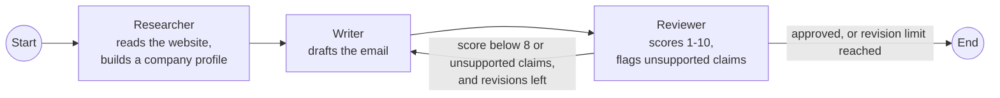

# LeadScout: multi-agent lead research with LangGraph

Enter a company's website and what you sell. A team of three AI agents researches the company, writes a personalized outreach email, and reviews it. If the reviewer isn't satisfied, the draft goes back to the writer with feedback. You watch every step live.

Built with **LangGraph, Claude, Python, FastAPI, Next.js and TypeScript**.

> Demo video: _add your Loom link here_ · Live demo: _add your URL here_

> **Production version:** the [Lead Research Agent Starter Kit](https://kimhoang36.gumroad.com/l/lead-research-kit?utm_source=github&utm_medium=readme&utm_campaign=lead-research-agents) adds batch CSV in and out (hundreds of leads, stop, resume and retry), passwords for you and your team, a daily spend cap, Caddy HTTPS, backups, and a one-command AWS deploy (about $0.23 per lead).


## The agent graph



| Agent | Input | Output (validated schema) |
|---|---|---|
| **Researcher** | Homepage plus up to 3 relevant pages (about, products, pricing, customers) | `CompanyProfile`: summary, products, customers, specific signals, likely needs |
| **Writer** | Company profile, your offer, and reviewer feedback when revising | `EmailDraft`: subject, body, facts used |
| **Reviewer** | Profile and draft | `Review`: score, problems, unsupported claims, feedback |

The reviewer loop is the point of the design: a single prompt tends to produce generic emails or invent facts, while a separate critic with the source profile catches both. The loop is capped (default 2 revisions) so cost stays predictable.

## Features

- **LangGraph state machine** with a conditional edge for the revision loop
- **Structured outputs**: every agent returns JSON validated against a Pydantic schema, so no fragile text parsing
- **Live streaming** of each agent's activity to the UI over Server-Sent Events, using LangGraph's `updates` and `custom` stream modes
- **Grounded writing**: the reviewer lists claims the research doesn't support, and those block approval
- **Cost per run** shown in the UI from real token usage
- **Safe website fetching**: blocks private and internal network addresses (SSRF protection), checks every redirect, and treats page text as untrusted data so it can't hijack the agents
- **Multi-language emails** (English, Vietnamese, Japanese and more)
- 19 backend tests and 3 frontend tests, GitHub Actions CI, Docker Compose

## Cost per run

Each run makes 3 Claude calls, plus 2 more for every revision. The UI shows the exact token count and estimated cost after each run. With the default settings (Claude Opus 5.5 at $4 / $20 per million input / output tokens, up to 4 pages of 6,000 characters each), expect roughly **$0.05 to $0.20 per lead**, depending on site size and revisions. Treat this as an estimate and check the number in the UI for your own runs. Set `CLAUDE_MODEL` to a smaller model and update the `PRICE_*` settings to lower it.

## Run locally

Requirements: Python 3.12+, Node 22+, and an [Anthropic API key](https://console.anthropic.com).

**Backend**

```bash
cd backend
python -m venv .venv && source .venv/bin/activate
pip install -r requirements-dev.txt
cp .env.example .env        # add your ANTHROPIC_API_KEY
uvicorn app.main:app --reload --port 8000
```

**Frontend**

```bash
cd frontend
npm install
cp .env.example .env.local
npm run dev
```

Open http://localhost:3000.

**Or with Docker**

```bash
cp backend/.env.example backend/.env   # add your key
docker compose up --build
```

To deploy on AWS, the same EC2 + Docker Compose steps work as in a typical two-container app: launch an Ubuntu instance, install Docker, clone the repo, set `PUBLIC_API_URL` and `PUBLIC_WEB_URL` to the server address, and run `docker compose up -d --build`.

## API

`POST /runs` with:

```json
{ "company_url": "example.com", "offer": "What you sell", "sender_name": "Your name", "language": "English" }
```

Streams SSE events:

| Event | Data |
|---|---|
| `step` | `{ agent, status: "started" \| "progress" \| "finished", message?, output? }` |
| `result` | `{ profile, email, review, approved, revisions, pages, cost }` |
| `error` | `{ message }` |

## Configuration

| Variable | Default | Purpose |
|---|---|---|
| `ANTHROPIC_API_KEY` | | Claude API key |
| `CLAUDE_MODEL` | `claude-opus-5-5` | Model used by all agents |
| `CLAUDE_EFFORT` | `medium` | Reasoning effort |
| `MAX_REVISIONS` | `2` | How many times the reviewer can send the draft back |
| `APPROVE_SCORE` | `8` | Minimum reviewer score to approve |
| `MAX_PAGES` / `MAX_CHARS_PER_PAGE` | `4` / `6000` | How much of the website the researcher reads |
| `PRICE_INPUT_PER_MTOK` / `PRICE_OUTPUT_PER_MTOK` | `4` / `20` | Used for the cost estimate |

## Tests

```bash
cd backend && pytest -q     # graph routing, revision loop, API stream, website reader, SSRF guard
cd frontend && npm test     # SSE parser and timeline logic
```

Claude and the network are mocked in tests, so they run offline in under a second.

## Project structure

```
backend/app/
  graph.py    LangGraph workflow, agent prompts, routing
  models.py   Pydantic schemas for each agent's output
  llm.py      Claude structured-output helper and cost estimate
  web.py      Website reader with SSRF protection
  main.py     FastAPI endpoint that streams the run
frontend/
  components/Workspace.tsx   form, live activity, results
  components/GraphView.tsx   workflow diagram with live highlighting
  lib/                       API client, SSE parser, timeline reducer
```

## Limitations and ideas

- Reads only the first 6,000 characters of each page, and can't read sites that need JavaScript to render.
- Add a web search tool for news and funding signals beyond the company's own site.
- Add a human approval step before the email is finalized (LangGraph interrupts).
- Batch mode: upload a CSV of leads and export all emails.

## Free version vs the production kit

This repo is the free, open-source version: great for learning and demos. The [Lead Research Agent Starter Kit](https://kimhoang36.gumroad.com/l/lead-research-kit?utm_source=github&utm_medium=readme&utm_campaign=lead-research-agents) is the version you can put in front of real users or clients.

| | This repo (free) | [Lead Research Agent Starter Kit](https://kimhoang36.gumroad.com/l/lead-research-kit?utm_source=github&utm_medium=readme&utm_campaign=lead-research-agents) |
|---|---|---|
| LangGraph researcher, writer and reviewer agents | ✅ | ✅ |
| Batch CSV of leads in, emails out, stop/resume/retry |  | ✅ |
| Admin and teammate passwords |  | ✅ |
| Daily spend cap and `/usage` report |  | ✅ |
| Production Docker Compose with Caddy HTTPS |  | ✅ |
| One-command AWS deploy, backups, deploy check |  | ✅ |

More production-ready Claude projects: [all starter kits](https://shipready-ai.github.io/?utm_source=github&utm_medium=readme&utm_campaign=lead-research-agents).

## License

MIT
